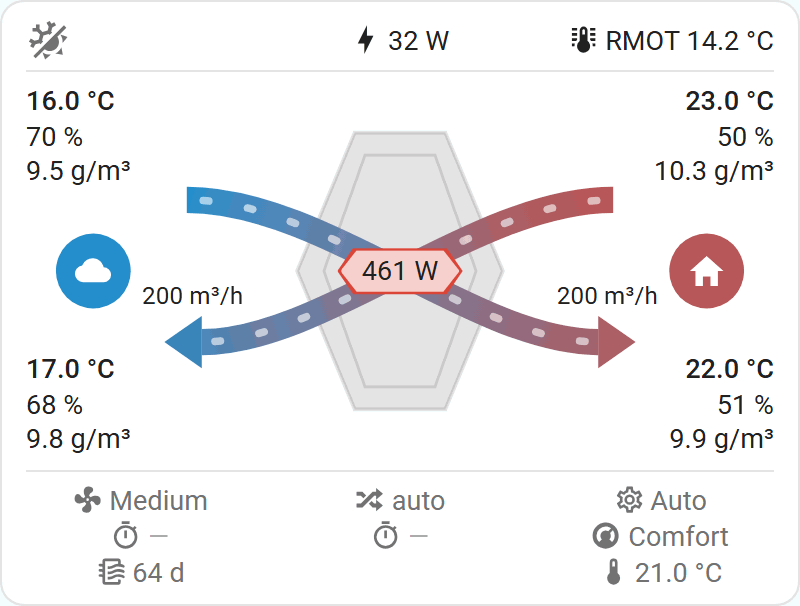
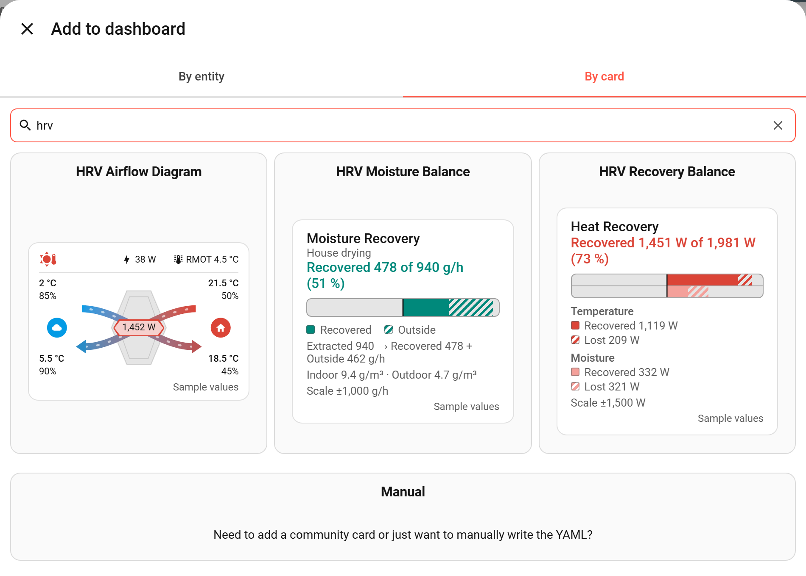
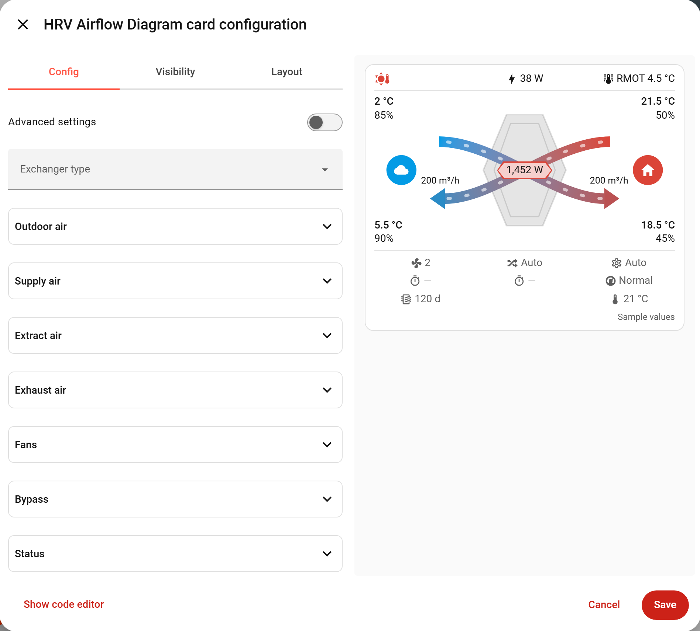
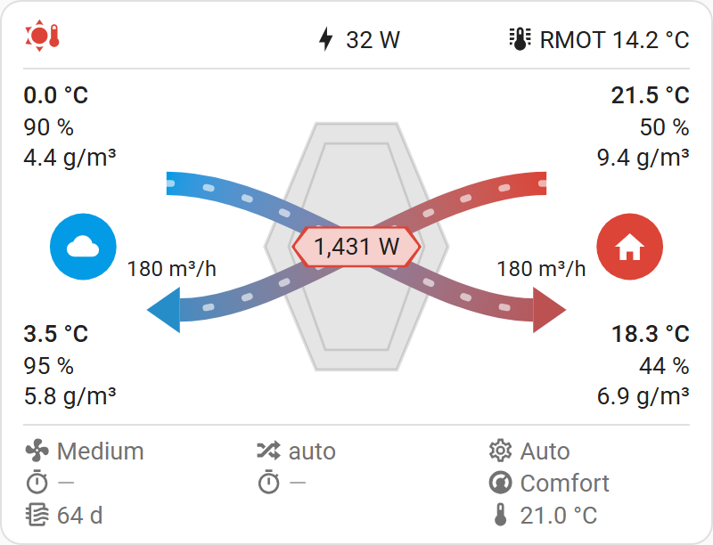
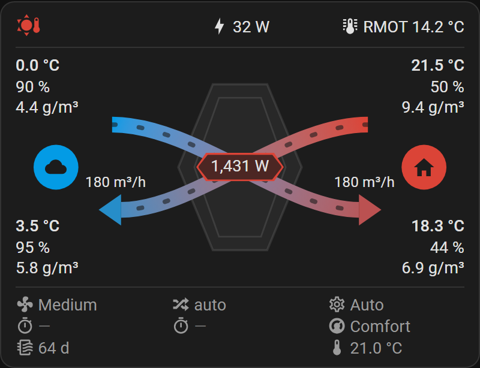
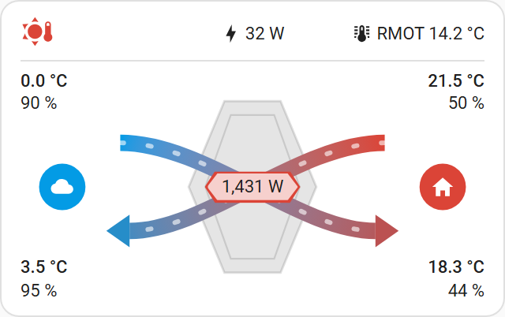
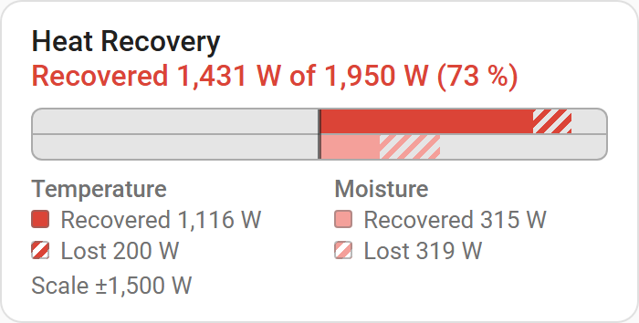
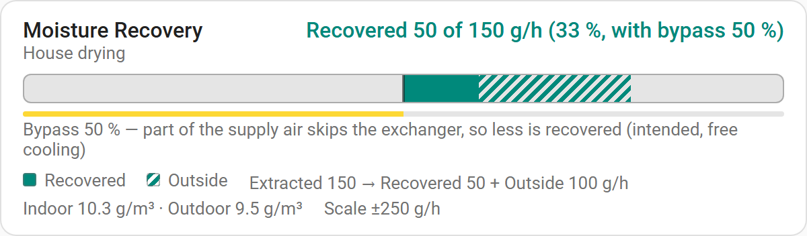

# HRV ventilation cards

Lovelace cards for heat and energy recovery ventilation units (HRV/ERV): a diagram of the unit's air streams and
two live bars for the heat and moisture the exchanger recovers.



## Features

- **Airflow diagram** (`custom:hrv-ventilation-card`): the four air streams around the exchanger, drawn by the
  card, coloured by temperature and animated in the direction of the air at a speed that follows the fan flow.
  The bypass path opens with the bypass position. Labels for temperature, humidity and flow, a saving badge in
  watts and, for an energy recovery unit, the moisture its exchanger recovers in g/h; a top row with the season,
  power and running mean outdoor temperature, and a status grid with the fan level, bypass mode and the unit's
  status. A compact layout for narrow columns, light and dark themes.
- **Recovery balance** (`custom:hrv-recovery-balance-card`): a live bar of the heat (or cooling) the exchanger
  recovers and what is still lost with the ventilation air, split into temperature (sensible) and moisture
  (latent) parts; with the bypass open on a mild day, the free cooling the supply air brings.
- **Moisture balance** (`custom:hrv-moisture-balance-card`): a live bar of the moisture the ventilation takes
  out of the house, how much of it the exchanger recovers and how much goes outside, or, when the outdoor air is
  more humid, how much it keeps out.
- The cards calculate everything from the unit's own sensors: no template sensors or other helpers needed.
- A visual editor for each card: pick the unit's sensors in groups per air stream, with the less common options
  behind an "Advanced settings" switch.

## Scope and requirements

- **Home Assistant:** developed and tested on 2026.10. Older versions are untested; a minimum is stated once
  checked.
- **Unit:** any heat or energy recovery ventilation unit whose sensors are in Home Assistant. Developed with a
  Zehnder ComfoAir Q450 (enthalpy exchanger) through ESPHome; other units are untested. With a plain HRV, which
  passes no moisture, the moisture figures should show close to nothing recovered.
- **Sensors per card** (the rest of each card's options are optional):

  | Card | Needs |
  |---|---|
  | Airflow diagram | Temperature of the outdoor, supply, extract and exhaust air. The badge also needs a humidity of the outdoor, supply and extract air and the supply flow. |
  | Recovery balance | Temperature of the outdoor, supply and extract air, and the supply flow. With a humidity on each of those three streams it adds the moisture (latent) part. |
  | Moisture balance | A humidity of the outdoor, supply and extract air, and the supply flow. A relative humidity also needs that stream's temperature. |

  The bypass position is optional on every card; without it the bypass counts as closed.
- **Units:** temperatures in °C or °F; flow in m³/h, L/s or ft³/min; relative humidity in %, absolute humidity in
  g/m³; the bypass position in %. A sensor in another unit counts as having no value.
- No helpers, integrations or other cards are needed.

## Installation

### HACS

The cards are not in the HACS default list yet; add this repository as a custom repository:

1. In Home Assistant, open **HACS**, the menu (top right) > **Custom repositories**.
2. Repository `https://github.com/peeter123/hrv-ventilation-card`, type **Dashboard**, then **Add**.
3. Search HACS for **HRV Ventilation Card**, open it and choose **Download**.
4. Reload the browser. HACS registers the dashboard resource itself, and the three cards are in the card picker.

New releases show up in HACS as updates.

### Manual

1. Download `dist/hrv-ventilation-card.js` from this repository (from the latest release for a released version).
2. Copy it to `/config/www/hrv-ventilation-card/` on your Home Assistant host (create the folder; `/config/www/`
   is served as `/local/`, without authentication). If `www` did not exist yet, restart Home Assistant.
3. Add it as a dashboard resource: **Settings** > **Dashboards** > menu (top right) > **Resources** > **Add
   resource**, URL `/local/hrv-ventilation-card/hrv-ventilation-card.js?v=1`, type **JavaScript module**. (In
   YAML mode, add the same URL under `lovelace: resources:`.)
4. Reload the browser. The three cards are now in the card picker.

**Updating:** copy the new file over the old one and raise the `?v=` number on the resource (`?v=2`, `?v=3`, ...).
Browsers keep `/local/` files for up to a month, so without a new URL they keep the old version; a hard refresh
helps a browser that still shows it.

## Usage

1. Open a dashboard, choose **Edit dashboard**, then **Add card** and the **By card** tab.
2. Search for "HRV" and pick **HRV Airflow Diagram**, **HRV Recovery Balance** or **HRV Moisture Balance**. The
   picker shows a rendered preview of each card. A new card starts with an empty config and shows sample
   values until you pick a sensor (see [Sample values](#sample-values)).

   

3. Open each group (outdoor air, supply air, extract air, fans, bypass, ...) and pick your unit's sensors.
   The preview updates as you go.
4. Turn on **Advanced settings** for the less common options, marked "Advanced" in [Options](#options): for
   example the absolute humidity sensors on the bars, smoothing, air density, scale, colours and the diagram's
   layout. The switch only changes what the editor shows; it is not saved, and it starts on for a card that has an
   advanced option set.

   An option you have not set shows its default (for example "Heat recovery (HRV)" as the exchanger type, and
   with the advanced settings on, the layout "Automatic") and stays unset: the YAML changes only at the field you
   edit, and a section that is in the YAML stays there, also when it ends up empty. Typing the default into an
   unset field leaves it unset; to pin a default, set it in the YAML (a default the YAML already sets stays).
   Clearing a field leaves it empty (the option becomes unset) and you can type a new value.
5. Save. **Show code editor** shows the same config as YAML; see [Options](#options) and [Examples](#examples).



### Sample values

A card whose config sets no sensor at all (only `type`, and optionally options) shows built-in sample values: a
heating day with outdoor air at 2 °C, supply 18.5 °C, extract 21.5 °C, exhaust 5.5 °C, 200 m³/h and the bypass
closed. A muted "Sample values" note at the bottom right marks it. This is what the card picker preview and a
freshly added card show. Options still apply, so `exchanger_type: erv` shows the ERV drawing and its moisture
figure, and an invalid option still gives a configuration error. Nothing in a sample card opens a more-info dialog.

To leave the sample, pick any sensor in the editor (or add any role to the YAML). The card then uses only your
sensors, and the preview names the required ones that are still missing until you have set them. The sample is
never mixed with real values.

## Options

### Airflow diagram card

`type: custom:hrv-ventilation-card`. A drawing of the unit: outdoor air (top left) runs through the exchanger to the
supply air (bottom right, into the house), extract air (top right) to the exhaust air (bottom left). Each stream end
shows its temperature and humidities and is coloured by its temperature; the supply and exhaust flow show below
the tips of their arrows, the bypass position at the top of the exchanger and the saving badge, shaped like the
exchanger, on its centre. On an energy recovery unit (`exchanger_type: erv`) the exchanger is blue-grey instead of
grey and shows the moisture it recovers right of the exchanger. A top row holds the season (left), the power (centred,
followed by the pre-heater's power while it heats) and the running mean outdoor temperature (right), and a status grid
below the drawing the fan level, the bypass mode, the unit's status and the pre-heater's energy.
Every label there has an icon in front (lightning bolt for power, heat wave for the pre-heater, fan, crossing arrows
for the bypass, timer, cog, thermometer, thermostat, air filter, thermometer with lines for RMOT), centred on its text, and a tooltip with its
name and state. Each status value is centred in its column; one too long for it ends in an ellipsis. Every label opens
Home Assistant's more-info dialog of its sensor, and shows the state as Home Assistant formats it (unit, display
precision, number format). Options marked "Advanced" are shown in the visual editor when its "Advanced settings"
switch is on.

| Light theme | Dark theme | Compact (below 340 px) |
|---|---|---|
|  |  |  |


Only the four stream temperatures are required. Every other role is optional and leaves its label out when not
configured. The top row is shown while power, the pre-heater power, the running mean outdoor temperature or a season sensor is configured,
the status grid while one of its roles is; a row does not come and go with the states, so the card keeps its height.

| Name | Type | Default | Advanced | Description |
|---|---|---|---|---|
| `exchanger_type` | text | `hrv` | | `hrv` (heat recovery) or `erv` (energy recovery, which also passes moisture); see below. |
| `outdoor` | object | | | Outdoor air, see [Stream](#stream-object). Temperature required. |
| `supply` | object | | | Supply air (into the house), see [Stream](#stream-object). Temperature required. |
| `extract` | object | | | Extract air (from the house), see [Stream](#stream-object). Temperature required. |
| `exhaust` | object | | | Exhaust air (out of the unit), see [Stream](#stream-object). Temperature required. |
| `fans` | object | | | Fan level and flows, see [Fans](#fans-object). |
| `bypass` | object | | | Bypass position, mode and next change, see [Bypass](#bypass-object). |
| `status` | object | | | The unit's status, see [Status](#status-object). |
| `pre_heater` | object | | | The pre-heater's power and energy, see [Pre-heater](#pre-heater-object). |
| `seasons` | object | | | Heating and cooling season, see [Seasons](#seasons-object). |
| `animation` | object | | | Moving air along the streams, see [Animation](#animation-object). |
| `show_effectiveness` | boolean | `false` | | Draw rings on the exchanger: the total effectiveness (thin inner ring) and, on an ERV with humidity for every stream, the moisture effectiveness (wide ring in the rim); see below. |
| `smoothing` | number | `10` | yes | Minutes over which absolute humidity is averaged for the badge (0 to 1440, 0 = off). |
| `air_density` | number | `1.2` | yes | Air density in kg/m³ for the badge (0.5 to 1.5); about 1.0 at 1500 m altitude. |
| `colors` | object | | yes | Cold and warm colour, see [Colours](#colours-object). |
| `layout` | text | `auto` | yes | `auto`, `full` or `compact`; see below. |
| `show_unavailable` | boolean | `false` | yes | Show labels whose sensor is unavailable or unknown with Home Assistant's text, instead of hiding them. The closed bypass position and the next changes stay hidden (see below). |

On the diagram the stream's `absolute_humidity` is a shown label, so its picker is not an advanced setting there.

#### Status object

| Name | Type | Default | Advanced | Description |
|---|---|---|---|---|
| `operating_mode` | entity | | | Operating mode (status grid). |
| `target_temperature` | entity | | yes | Profile target temperature (status grid). |
| `temperature_profile` | entity | | yes | Temperature profile (status grid). |
| `next_fan_change` | entity | | yes | Time to the next fan change (status grid); a dimmed dash while it is "n/a" or unknown. |
| `filter_days` | entity | | | Days until the filter change (status grid, air filter icon). |
| `power` | entity | | | Power use of the unit (top row, lightning bolt). |
| `rmot` | entity | | | Running mean outdoor temperature (top row, "RMOT "). |
| `heating_saving` | entity | | yes | Saved heating power sensor, opened by tapping the saving badge when it reads more than the cooling saving, or by default in heating mode. Not shown as a label. |
| `cooling_saving` | entity | | yes | Saved cooling power sensor, opened by tapping the saving badge when it reads more than the heating saving, or by default in cooling mode. Not shown as a label. |
| `moisture_recovery` | entity | | yes | Moisture recovery rate sensor, opened by tapping the ERV's moisture figure. Not shown as a label. |

#### Pre-heater object

| Name | Type | Default | Advanced | Description |
|---|---|---|---|---|
| `power` | entity | | | Pre-heater power: a sensor in W or kW, or an on/off entity (sensor, binary sensor or switch). Draws the coil on the diagram. |
| `energy` | entity | | | The pre-heater's energy sensor. Shown in the status grid (second column, bottom cell, heat wave icon). |
| `max_power` | number | | yes | Rated power of the pre-heater in W (1 to 4000). Without it the coil glows fully at any power above 0. |
| `glow_color` | color | `#ff9800` | yes | The colour the coil glows in while the heater is on: a CSS colour, by default a warm orange. |

A unit with a pre-heater (a heating coil that warms the outdoor air against frost) gets a coil drawn along the
outdoor stream, on the straight inlet before the bypass splits off (so it stays on the stream with the bypass open),
when `pre_heater.power` is configured. The coil is a smooth wave from one border of the stream to the other. It is dim (the secondary text
colour) while the heater is off or its entity is unavailable or unknown, and glows in `glow_color` (orange by
default) when it heats. The glow starts bright: the share of the glow colour is 30 % plus 70 % of the level, so a
heater at a quarter of its power already glows clearly orange. While the coil is on and the animation is on, the glow
pulses gently (a slow cycle of about 2.5 s, between its level and 60 % of it); with `animation.enabled: false` or while
the device asks for reduced motion it is steady:

- With a power sensor and `max_power`, the glow grows with the power as a share of the maximum. It is at least a tenth
  while the heater draws any power, so a modulating heater at a few percent does not look off, and full at the maximum
  or above. The level is what the share above is taken from, e.g. 250 of 1,000 W is a level of 0.25, 47.5 % glow
  colour.
- With a power sensor and no `max_power`, any power above 0 is full.
- With an on/off entity, the coil glows fully while it is on and is dim while it is off. `max_power` has no effect.

Hovering the coil shows "Pre-heater: " and the state as Home Assistant formats it; tapping it opens the more-info
dialog of `pre_heater.power`.

The same state also shows in the top row, in the centre after the power, with a heat wave icon and the tooltip
"Pre-heater: " and the state; tapping it opens `pre_heater.power`. It is there only while the pre-heater is on and
its entity is available. Otherwise it is left out, not hidden, so the power stays centred while the heater is off.
`pre_heater.power` alone is enough to show the top row. The two figures stand side by side: the card adds them up
nowhere and shows no share, because whether a unit's power reading includes its pre-heater differs per unit.

`pre_heater.energy` shows in the status grid in the second column's bottom cell, after a heat wave icon, with the tooltip
"Pre-heater energy: " and its state (for example "12 kWh"); tapping it opens that sensor. The cell above it holds the
next bypass change.

In the visual editor the pre-heater has its own group after the status group. The basic fields are the power
(a sensor, binary sensor or switch) and the energy (a sensor); the maximum power and the glow colour are advanced.

#### Seasons object

| Name | Type | Default | Advanced | Description |
|---|---|---|---|---|
| `heating` | binary sensor | | | On during the heating season. |
| `cooling` | binary sensor | | | On during the cooling season. |

The top row shows one season icon: heating season while `heating` is on (also when both are on), cooling season
while `cooling` is on, and between seasons while both are configured and both are off. With only one of them
configured and off, there is no icon, because between seasons cannot be told apart from the other season. The icon
has a tooltip; tapping it opens the season sensor that is on, or the heating one between seasons.

#### Colours object

One CSS colour each, in the formats of [Mode colours](#mode-colours-object).

| Name | Type | Default | Advanced | Description |
|---|---|---|---|---|
| `cold` | colour | `#039be5` | yes | Colour of the coldest stream end, the cold badge and the cooling season icon. |
| `warm` | colour | `#db4437` | yes | Colour of the warmest stream end, the warm badge and the heating season icon. |

Each stream end is coloured by its temperature's place in a range centred midway between the coldest and the warmest
of the four temperatures, as wide as their spread but at least 10 K: on a mild day with almost equal temperatures
all ends stay near the middle colour. Temperatures in °C and °F are compared alike; an unavailable temperature, or
one in another unit, makes its end grey.

#### Animation object

| Name | Type | Default | Advanced | Description |
|---|---|---|---|---|
| `enabled` | boolean | `true` | | Move dashes along the streams in the direction of the air. |
| `nominal_flow` | number | | yes | Flow at which the air moves at medium speed, in the unit of the flow sensors (1 to 100000). |

The moving dashes follow each drawn path at its strength, so with the bypass half open half of the moving air takes
the bypass. A stream with a flow sensor (`fans.supply_flow`, `fans.exhaust_flow`) stands still while it reads 0.
Otherwise it moves at medium speed, or, with `nominal_flow`, at its flow divided by `nominal_flow`, between a
quarter and twice the medium speed. A stream without a flow sensor, or whose sensor has no value, moves at medium
speed. The animation is off with `enabled: false` and while the device asks for reduced
motion; the drawing is the same, without movement.

**Saving badge.** The badge shows the saving of the same calculation as the recovery balance card, in W: tinted with
the warm colour in heating mode and with the cold colour in cooling mode while the saving is above 0.5 W, otherwise
grey. It needs the calculation's sensors: the outdoor, supply and extract temperatures, a humidity for each of those
three streams (see [Stream](#stream-object)) and `fans.supply_flow`; without them there is no badge. While one of
them has no value the badge is hidden, or shows "n/a" with `show_unavailable: true`. Tapping it opens the
`status.heating_saving` or `status.cooling_saving` sensor, whichever reads the higher power (both converted to W).
With only one of them set, a reading that is not a number or equal readings, it opens the sensor of the current mode
(heating or cooling); without that sensor, or without a calculated saving, the badge is not tappable.

**Exchanger type.** `hrv` (heat recovery, the default) draws the exchanger grey. `erv` (energy recovery, an enthalpy
exchanger that also passes moisture) draws it blue-grey, derived from the theme so it stays legible in light and
dark themes, and shows the moisture recovery figure right of the exchanger: the moisture the exchanger hands back to the
supply air, in g/h, from the same calculation and sensors as the badge. An icon says which way it goes: water-sync
while moisture is recovered (the exchanger hands it back) and water-remove while the exchanger keeps moisture out
(the outdoor air is more humid than the indoor air). The number is the size of the rate, without a sign, and the
tooltip says which. On narrow cards the unit moves to a second line under the number. It is hidden or "n/a" like the
badge, is shown in both layouts, and tapping it opens the `status.moisture_recovery` sensor, if configured. The type
changes only the drawing: the calculation and the bar cards are the same for both.

**Effectiveness rings.** With `show_effectiveness: true` the exchanger gets progress rings that start at its top
centre and run clockwise; a full ring is 100 %. The thin inner ring, on the inner outline, is the total
effectiveness: the share of the total heat (sensible plus latent) that the exchanger recovers, the same percentage as
the recovery balance card's header, in every mode. It is in the warm colour in heating mode and the cold colour in
cooling mode, darkened on a light theme and lightened on a dark one so it stays visible against the exchanger. The wide
ring, in the rim of the exchanger and clipped to it, is the moisture effectiveness, in a blue-grey a little darker
(light theme) or lighter (dark theme) than the exchanger; the empty rim is its track. It is drawn on an ERV
(`exchanger_type: erv`) with a humidity for the outdoor, supply and extract stream, and never on an HRV, which gets
the total ring only. The figures are those of the calculation described in
[docs/hrv-ventilation.md](docs/hrv-ventilation.md#formulas): supply side, limited to 0 to 100 %, and from the same
sensors as the badge. The total counts the latent heat of moisture that is not handed back as lost, so an HRV, or an
ERV that passes little moisture, scores lower than its temperature ratio. The rings are drawn only with the inputs of
the sensible calculation (the three temperatures and `fans.supply_flow`); the moisture ring also needs the
humidities. The air streams are drawn over the rings, so a stream covers part of each slanted side; the top and
bottom edges stay visible. The tooltip of the exchanger and its accessible name give the figures with the mode and the
absolute values behind them, for example "Effectiveness: heat 92 % (1,200 / 1,304 W), moisture 65 % (390 / 600
g/h)" (modes: heat, cooling, free cooling), with "not measurable" for a ring without a value and, while the bypass
is above 0 %, its position. The recovered value gets a minus sign (−) while it works against the potential (the
ratio is then 0 %), for example "free cooling 0 % (−120 / 1,000 W)".

A ring shows no progress while its figure is left out: with a supply flow of 0 (nothing to recover, as the recovery
card's header), the total below a gate (the extract and outdoor air differ in
enthalpy by less than that of 3 K of dry air), the moisture below 1.5 g/m³ of absolute humidity difference, because
the ratio is noise there, or while an input has no value. There is no gate on the bypass for the total, so with the bypass open it describes the unit as a whole:
it falls as the bypass opens, because the supply air is then partly outdoor air. Read it together with the bypass
position.

**Layout.** With `layout: auto` the card switches to a compact layout below 340 px card width: only the four
temperatures and relative humidities, the badge, the bypass position, the moisture figure (ERV) and the top row,
without the flows, the absolute humidities and the status grid, so very narrow cards stay legible. A full-width card on a phone is about
16 px narrower than the screen, so phones from 360 px wide show the full layout and only narrower screens or columns
get the compact one. `full` and `compact` force one layout, for example `compact` on a phone you find too busy.
Text stays at least 11 px high. The bypass position label is hidden while the bypass is closed; the next bypass change and next
fan change show a dimmed dash while nothing is planned ("n/a" or unknown).

**Status grid.** Below the drawing, under a separator line like the one below the top row, the status values sit in
three centred columns with a fixed cell each, so nothing moves when a value changes: the fans (fan level, next fan change, filter days), the bypass (mode, next change) and comfort
(operating mode, temperature profile, target temperature). A value that is not configured leaves its cell empty.

### Recovery balance card

`type: custom:hrv-recovery-balance-card`. The bar of heat (or, on a hot day, cooling) that the exchanger recovers
and that is still lost with the ventilation air, split into temperature (sensible) and moisture (latent) parts.
While the bypass is open and the outdoor air has a lower enthalpy than indoors (it is cooler, or drier), the card
shows "Free Cooling" instead: the
cooling the supply air brings compared with the indoor air, of what fully outdoor air would bring ("Cooling X W of
Y W"), with what it falls short of that shown as "Missed" rather than "Lost". The legend gives each lane's recovered
and lost power and the bar's scale; the moisture recovery rate in g/h is on the moisture balance card. The card calculates it from the unit's sensors; it needs no helpers. Options marked "Advanced" are
shown in the visual editor when its "Advanced settings" switch is on. A sensor that is unavailable or reports a unit
the card does not know (see the types below) makes the bar show "n/a".



| Name | Type | Default | Advanced | Description |
|---|---|---|---|---|
| `outdoor` | object | | | Outdoor air (before the unit), see [Stream](#stream-object). Temperature required. |
| `supply` | object | | | Supply air (into the house), see [Stream](#stream-object). Temperature required. |
| `extract` | object | | | Extract air (from the house), see [Stream](#stream-object). Temperature required. |
| `fans` | object | | | `supply_flow`: supply air flow sensor (m³/h, L/s or ft³/min). Required. |
| `bypass` | object | | | `position`: bypass position sensor (%). Optional; without it the bypass counts as closed. |
| `smoothing` | number | `10` | yes | Minutes over which absolute humidity is averaged (0 to 1440, 0 = off). |
| `air_density` | number | `1.2` | yes | Air density in kg/m³ (0.5 to 1.5); about 1.0 at 1500 m altitude. |
| `min_scale` | number | `500` | yes | Watts that fill half the bar at least (50 to 100000); larger values grow it in steps of 250 W. |
| `heating` | object | | yes | Colours in heating mode, see [Mode colours](#mode-colours-object). |
| `cooling` | object | | yes | Colours in cooling mode, see [Mode colours](#mode-colours-object). |

#### Stream object

Used by `outdoor`, `supply` and `extract` (and, on the diagram card, `exhaust`). With both humidities on a stream, the
absolute humidity is used; a relative humidity also needs the stream's temperature.

- Airflow diagram card: the temperature is required; the humidities are shown as labels.

- Recovery balance card: the temperature is always required. Humidity is all or nothing: give every stream a
  humidity, or none, which makes the bar sensible-only; a humidity on only some streams is a configuration error.
- Moisture balance card: every stream needs a humidity; a temperature only for a stream with a relative humidity.

| Name | Type | Default | Advanced | Description |
|---|---|---|---|---|
| `temperature` | entity | | | Temperature sensor (°C or °F). |
| `humidity` | entity | | | Relative humidity sensor (%); absolute humidity is then computed with the temperature. |
| `absolute_humidity` | entity | | yes | Absolute humidity sensor (g/m³), used instead of the relative humidity. |

#### Fans object

| Name | Type | Default | Advanced | Description |
|---|---|---|---|---|
| `level` | entity | | | Fan level (diagram card only, status grid). |
| `supply_flow` | entity | | | Supply air flow sensor. Optional on the diagram card, where it shows above the supply arrow, sets the supply air's animation speed and is needed for the badge. |
| `exhaust_flow` | entity | | | Exhaust air flow sensor (diagram card only, above the exhaust arrow, and the exhaust air's animation speed). |

#### Bypass object

| Name | Type | Default | Advanced | Description |
|---|---|---|---|---|
| `position` | entity | | | Bypass position sensor (%). |
| `mode` | entity | | | Bypass mode (diagram card only, status grid, crossing arrows). |
| `next_change` | entity | | yes | Time to the next bypass change (diagram card only, status grid); a dimmed dash while it is "n/a" or unknown. |

#### Mode colours object

Used by `heating` and `cooling`. One CSS colour: a hex value (`#db4437`), a name (`orange`), a colour function with
numbers (`rgb(219, 68, 55)`, `hsl(5, 70%, 54%)`, `oklch(62% 0.2 28)`) or a theme variable (`var(--accent-color)`).

| Name | Type | Default | Advanced | Description |
|---|---|---|---|---|
| `color` | colour | `#db4437` (heating), `#039be5` (cooling) | yes | Temperature part, header and swatches. |
| `color_latent` | colour | `#f4a09a` (heating), `#8fd3f7` (cooling) | yes | Moisture part. |

**Smoothing.** Many units report relative humidity in whole percent, so absolute humidity moves in steps of about
0.2 g/m³, about 50 g/h of moisture at 230 m³/h. The card therefore averages absolute humidity over `smoothing`
minutes, time-weighted, like Home Assistant's `time_simple_moving_average` filter. This applies to absolute
humidity sensors and to absolute humidity computed from relative humidity alike. The window is filled from the
recorder's history when the card loads; until that has arrived, the card shows the current values. If your sensors
are already averaged (for example by a filter helper), pick those and set `smoothing: 0`, so they are not averaged
twice.

### Moisture balance card

`type: custom:hrv-moisture-balance-card`. The bar of moisture that ventilation takes out of the house, all relative
to the outdoor air: **extracted = recovered + put outside**. Its title is "Moisture Recovery", with the direction in
a muted subtitle under it: "House drying", "House gaining (outdoor more humid)" or "Indoor ≈ outdoor". The extract air carries moisture above the outdoor
level (extracted); the exchanger hands part of it back to the supply air (recovered); the rest goes outside. Positive
means moisture leaves the house (drying, the bar grows right); negative means the outdoor air is more humid and the
house gains moisture (the bar grows left), and the words change to "Kept Out" and "Enters". When indoor and outdoor
absolute humidity differ by less than the neutral threshold, the figures are within sensor accuracy and the card
says so instead of a percentage. With the bypass open, a strip shows its position: part of the supply air skips the
exchanger, so less is recovered.

Every sensor the card reads must have a value (the humidities, the temperature of each stream with a relative
humidity, the supply flow and, when configured, the bypass position); otherwise the whole card shows "n/a", because the neutral band and
the bypass note decide how the figures may be read. Options marked "Advanced" are shown in the visual editor when its
"Advanced settings" switch is on.



| Name | Type | Default | Advanced | Description |
|---|---|---|---|---|
| `outdoor` | object | | | Outdoor air, see [Stream](#stream-object). A humidity is required. |
| `supply` | object | | | Supply air, see [Stream](#stream-object). A humidity is required. |
| `extract` | object | | | Extract air (indoor), see [Stream](#stream-object). A humidity is required. |
| `fans` | object | | | `supply_flow`: supply air flow sensor, see [Fans](#fans-object). Required. |
| `bypass` | object | | | `position`: bypass position sensor (%), see [Bypass](#bypass-object). Optional; without it no strip. |
| `smoothing` | number | `10` | yes | Minutes over which absolute humidity is averaged (0 to 1440, 0 = off). |
| `air_density` | number | `1.2` | yes | Air density in kg/m³ (0.5 to 1.5). Accepted so blocks can be copied between the cards; the moisture rates do not depend on it. |
| `neutral_threshold` | number | `0.3` | yes | Indoor-outdoor difference in g/m³ (0 to 5) below which the figures count as within sensor accuracy. |
| `min_scale` | number | `250` | yes | Grams per hour that fill half the bar at least (50 to 100000); larger values grow it in steps of 250. |
| `drying_color` | colour | `#00897b` | yes | Colour while the house dries (see [Mode colours](#mode-colours-object) for the formats). |
| `gaining_color` | colour | `#8e24aa` | yes | Colour while the house gains moisture. |

The stream objects are those of the recovery balance card; here a temperature is only needed for a stream with a
relative humidity. The same smoothing applies.

## Examples

The entity IDs below are placeholders; pick your unit's sensors in the visual editor.

### Airflow diagram card

Minimal, the four temperatures:

```yaml
type: custom:hrv-ventilation-card
outdoor:
  temperature: sensor.hrv_outdoor_air_temperature
supply:
  temperature: sensor.hrv_supply_air_temperature
extract:
  temperature: sensor.hrv_extract_air_temperature
exhaust:
  temperature: sensor.hrv_exhaust_air_temperature
```

Full:

```yaml
type: custom:hrv-ventilation-card
exchanger_type: erv
outdoor:
  temperature: sensor.hrv_outdoor_air_temperature
  humidity: sensor.hrv_outdoor_air_humidity
  absolute_humidity: sensor.hrv_outdoor_air_absolute_humidity
supply:
  temperature: sensor.hrv_supply_air_temperature
  humidity: sensor.hrv_supply_air_humidity
  absolute_humidity: sensor.hrv_supply_air_absolute_humidity
extract:
  temperature: sensor.hrv_extract_air_temperature
  humidity: sensor.hrv_extract_air_humidity
  absolute_humidity: sensor.hrv_extract_air_absolute_humidity
exhaust:
  temperature: sensor.hrv_exhaust_air_temperature
  humidity: sensor.hrv_exhaust_air_humidity
  absolute_humidity: sensor.hrv_exhaust_air_absolute_humidity
fans:
  level: sensor.hrv_fan_level
  supply_flow: sensor.hrv_supply_fan_flow
  exhaust_flow: sensor.hrv_exhaust_fan_flow
bypass:
  position: sensor.hrv_bypass_position
  mode: sensor.hrv_bypass_mode
  next_change: sensor.hrv_next_bypass_change
status:
  operating_mode: sensor.hrv_operating_mode
  target_temperature: sensor.hrv_profile_target_temperature
  temperature_profile: sensor.hrv_temperature_profile
  next_fan_change: sensor.hrv_next_fan_change
  filter_days: sensor.hrv_filter_remaining_days
  power: sensor.hrv_power
  rmot: sensor.hrv_running_mean_outdoor_temperature
  heating_saving: sensor.hrv_saved_heating_power
  cooling_saving: sensor.hrv_saved_cooling_power
  moisture_recovery: sensor.hrv_moisture_recovery
pre_heater:
  power: sensor.hrv_pre_heater_power
  energy: sensor.hrv_pre_heater_energy
  max_power: 1500
  glow_color: '#ff9800'
seasons:
  heating: binary_sensor.hrv_heating_season
  cooling: binary_sensor.hrv_cooling_season
animation:
  enabled: true
  nominal_flow: 300
show_effectiveness: false
smoothing: 10
air_density: 1.2
colors:
  cold: '#039be5'
  warm: '#db4437'
layout: auto
show_unavailable: false
```

### Recovery balance card

Minimal, temperatures only (sensible heat):

```yaml
type: custom:hrv-recovery-balance-card
outdoor:
  temperature: sensor.hrv_outdoor_air_temperature
supply:
  temperature: sensor.hrv_supply_air_temperature
extract:
  temperature: sensor.hrv_extract_air_temperature
fans:
  supply_flow: sensor.hrv_supply_fan_flow
```

Full:

```yaml
type: custom:hrv-recovery-balance-card
outdoor:
  temperature: sensor.hrv_outdoor_air_temperature
  humidity: sensor.hrv_outdoor_air_humidity
supply:
  temperature: sensor.hrv_supply_air_temperature
  humidity: sensor.hrv_supply_air_humidity
extract:
  temperature: sensor.hrv_extract_air_temperature
  absolute_humidity: sensor.hrv_extract_air_absolute_humidity
fans:
  supply_flow: sensor.hrv_supply_fan_flow
bypass:
  position: sensor.hrv_bypass_position
smoothing: 10
air_density: 1.2
min_scale: 500
heating:
  color: '#db4437'
  color_latent: '#f4a09a'
cooling:
  color: '#039be5'
  color_latent: '#8fd3f7'
```

### Moisture balance card

Minimal, relative humidities with their temperatures:

```yaml
type: custom:hrv-moisture-balance-card
outdoor:
  temperature: sensor.hrv_outdoor_air_temperature
  humidity: sensor.hrv_outdoor_air_humidity
supply:
  temperature: sensor.hrv_supply_air_temperature
  humidity: sensor.hrv_supply_air_humidity
extract:
  temperature: sensor.hrv_extract_air_temperature
  humidity: sensor.hrv_extract_air_humidity
fans:
  supply_flow: sensor.hrv_supply_fan_flow
```

Full:

```yaml
type: custom:hrv-moisture-balance-card
outdoor:
  absolute_humidity: sensor.hrv_outdoor_air_absolute_humidity
supply:
  absolute_humidity: sensor.hrv_supply_air_absolute_humidity
extract:
  absolute_humidity: sensor.hrv_extract_air_absolute_humidity
fans:
  supply_flow: sensor.hrv_supply_fan_flow
bypass:
  position: sensor.hrv_bypass_position
smoothing: 10
air_density: 1.2
neutral_threshold: 0.3
min_scale: 250
drying_color: '#00897b'
gaining_color: '#8e24aa'
```

## How it calculates

The cards compare the air streams by their **enthalpy**, the heat content of moist air per m³:
`h = ρ · 1006 · T + AH · (2501 + 1.86 · T)` in J/m³, with the temperature `T` in °C, the absolute humidity `AH` in
g/m³ and the air density `ρ` (option `air_density`, 1.2 kg/m³ by default). A power is the supply flow times an
enthalpy difference.

- **Heating or cooling.** The cards are in cooling mode while the bypass is open or the outdoor air has a higher
  enthalpy than the extract (indoor) air, and in heating mode otherwise. The unit's own season flags are not used:
  between seasons both are off.
- **Recovered and lost.** In heating mode the exchanger recovers `h_supply - h_outdoor`: what the supply air
  gained over plain outdoor air. The potential is `h_extract - h_outdoor`, the load without any recovery, and what
  is not recovered is lost. In cooling mode the reference is the extract or the outdoor air, whichever has the
  higher enthalpy, and the signs turn around. With the bypass open and the outdoor air below the indoor enthalpy,
  the same figures are **free cooling**: the cooling the supply air brings, of what fully outdoor air would bring.
  Because it uses the measured supply air, this stays right while the bypass modulates.
- **Temperature and moisture parts.** The moisture (latent) part of a difference is `2501 · ΔAH`, the rest is the
  temperature (sensible) part, so the two always add up to the total. They can have opposite signs, for example
  when the supply air is cooled but gains moisture.
- **Moisture rates** (g/h), all relative to the outdoor air: extracted = flow · (AH_extract - AH_outdoor),
  recovered = flow · (AH_supply - AH_outdoor), put outside = flow · (AH_extract - AH_supply), so
  extracted = recovered + put outside.
- **Smoothing.** Many units report relative humidity in whole percent, which makes absolute humidity jump in
  steps worth about 50 g/h. The cards average absolute humidity over the last `smoothing` minutes (10 by
  default), time-weighted, starting from the recorder history when the card loads.

The formulas in detail, with worked examples and the accuracy of the humidity sensors, are in
[`docs/hrv-ventilation.md`](docs/hrv-ventilation.md).

## Development

Requires Node.js 22 (22.13 or later), 24, or 26 or later: the range ESLint 10 and Vitest 5 support (not 23 or 25).

```sh
npm install                      # dependencies
npx playwright install chromium  # browser for the browser test project (once per machine)
npm run dev                      # preview page with mock states (dev/), reloads on every source change
npm run build                    # bundle into build/hrv-ventilation-card.js (git-ignored, never deployed)
npm test                         # both test projects: unit (happy-dom) and browser (Chromium)
npm run test:unit                # unit tests only
npm run test:browser             # browser tests only
npm run check:ids                # build, then fail if the bundle holds an installation's entity IDs or prefixes
npm run typecheck                # tsc for the card code and the config files
npm run lint                     # ESLint
npm run format                   # Prettier (code, JSON, YAML; Markdown is not formatted)
npm run check                    # typecheck + lint + format check + both test projects + check:ids
npm run release                  # check, build, load the build and copy it to dist/ if all cards register
npm run capture                  # README images of the three cards from the preview page into docs/images/
```

**README images:** `npm run capture` (`scripts/capture.mjs`) starts its own Vite server, drives the preview page
with Playwright and writes the diagram in light and dark theme, the compact layout and on an ERV, the recovery bar,
the moisture bar and the animated GIF of the bypass opening and closing (encoded in Node with `gifenc`, at most
3 MB). The mock states keep installation identifiers out of view. Two images are taken by hand from a live
dashboard: `editor.png` (the diagram card's visual editor, opened from the card picker so no sensor is chosen) and
`card-picker.png`; check them for entity IDs with a device serial and for host names before committing.

Only `npm run release` writes `dist/`; `npm run build` writes `build/`, so a work-in-progress bundle cannot end up
in the deployed folder. `dist/` is committed, because deploys and HACS read it from the repo. `npm run release`
builds once into `build/`, loads that bundle in happy-dom and copies it to `dist/` only when it registers all
three cards (`scripts/check-release.mjs`), so an unfinished bundle cannot replace the working one.

**Preview page:** `npm run dev` opens `dev/index.html`, which renders the three cards from the source, stacked as in
a dashboard column, at 280, 320, 350, 400 and 600 px in a light and a dark theme. Its controls set the mock states
(temperatures, humidities, the flow, bypass position, season, unavailable entities) and the card options (config,
layout, show unavailable, animation, nominal flow, smoothing). The flow is one value for supply and exhaust, as the
unit keeps them in balance. Smoothing is off by default, so the bars follow the controls at once. The scenario
buttons fill in all the states at once: heating (winter), cooling (summer), bypass 50 % (off season) and bypass
100 % (night cooling). Each theme also has a "no entities (sample values)" row with the cards in sample mode. A card whose config it rejects shows the error in its place. `dev/ha-stubs.ts` stands in
for Home Assistant's `ha-card` and `ha-icon`, so the page needs no Home Assistant.

**Live checks:** the scripts that drive a live Home Assistant in a browser read `HA_URL` and `HA_TOKEN` (a
long-lived access token of an admin user) from `.env`. Copy `.env.sample` to `.env` and fill it in; `.env` is
git-ignored. The cards and the tests do not need it.

**Claude Code hook:** `.claude/settings.json` runs `scripts/check-on-edit.mjs` after every Edit or Write. For a
TypeScript file (`.ts`, `.mts`, `.cts`, `.tsx`) under `src/`, `test/` or `dev/` it formats the file with Prettier,
lints it with ESLint (warnings count as failures), type-checks the card code (`tsconfig.json`) and runs the related
`unit` tests, and reports failures back to Claude (exit code 2). When Prettier changed the file it says so, because
Claude's copy is then stale. Other files are skipped. The `browser` tests and the type check of the config files
and scripts (`tsconfig.node.json`, with `checkJs`) only run in `npm run check`. Project hooks only load when Claude
Code is started in this folder, not in the parent workspace, so start implementation sessions here (the `/opsx:*`
commands need that too).

### Layout

| Path | What | Deployed to (by the workspace's `../scripts/deploy.ps1`) |
|---|---|---|
| `src/` | TypeScript sources of the cards | not deployed (bundled) |
| `test/` | Unit and browser tests | not deployed |
| `dev/` | Preview page with mock states (`npm run dev`) | not deployed |
| `scripts/` | Development scripts: the Claude Code hook, the release step (`check-release.mjs`) and the README captures (`capture.mjs`) | not deployed |
| `docs/images/` | README images | not deployed |
| `dist/` | Card module (release build) | `/config/www/custom/hrv-ventilation-card/` |
| `build/` | Development build (git-ignored) | not deployed |
| `docs/hrv-ventilation.md` | How the cards calculate: formulas, moisture, accuracy, card behaviour | not deployed |
| `private/` | Git-ignored notes and the formula macro of the author's installation (entity IDs, helper and dashboard IDs) | the macro to `/config/custom_templates/` |
| `hacs.json` | HACS metadata | not deployed |
| `openspec/` | OpenSpec specs and planned changes (`openspec/changes/`) | not deployed |
| `.claude/` | Claude Code hook settings, OpenSpec skills and `/opsx:*` commands | not deployed |

`dist/` with a JS file named after the repository is what HACS looks for in a Dashboard repository.

## Roadmap

Planned with OpenSpec (CLI `openspec`, installed globally with npm).

- **Done: configurable cards** (v0.1.0; `openspec/changes/archive/2026-10-15-configurable-cards/`, specs in `openspec/specs/`): TypeScript + Lit rewrite, every entity
  from the card config, visual editors, the drawn diagram, and the migration of the author's dashboards.
- **Done: calculation in the card.** The cards calculate from the unit's raw sensors and need no helpers.
- **Done: v0.2 of the cards** (released), with improvements to the cards themselves.
- **Next: a custom integration for history and energy statistics.** The cards show the present only. Power,
  energy, effectiveness and moisture rate sensors for charts and the energy dashboard come from template, filter
  and Riemann helpers in the author's installation today (a Jinja macro hard-coded to one unit); an integration
  will create them from the raw sensors with the same formulas. The cards will not depend on it.
- **Then: packaging.** Inclusion in the HACS default list, README badges, release automation, and whether the
  integration ships the cards. HACS installation as a custom repository and releases are available now.

Still fixed in the cards: the texts are English only, and the figures are in W and g/h.

## Licence

[MIT](LICENSE)
